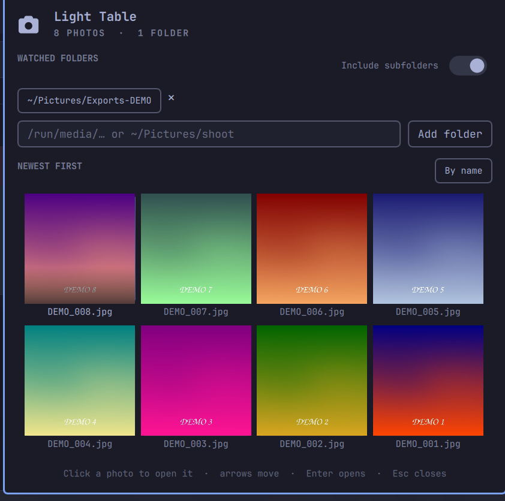

# Light Table

An Omarchy bar widget for photographers: point it at the folders you shoot into
and the newest photos show up as thumbnails in a popup. Click one and it opens
in your default image viewer.



## What it does

- Watches one or more folders and lists the images in them, newest first (or by
  name), as thumbnails.
- **Includes subfolders by default** (up to five levels down), because shoots
  live in dated folders — a top-level-only view of `Exports/` would be empty.
  The switch beside *WATCHED FOLDERS* turns that off.
- Reacts as you work: a file that lands in a watched folder (camera tether,
  export, rsync, a card copy) appears within a second — `inotifywait` drives a
  debounced rescan, with a 30s safety rescan for network mounts.
- Clicking a thumbnail opens it in whatever handles that file type
  (`gio open`, falling back to `xdg-open`).
- The bar icon carries the number of photos it is holding.
- Folder list, sort order and the item cap live in the plugin's own
  `shell.json` entry — no separate config file.

Formats: anything ImageMagick can read, which here includes JPEG, PNG, WebP,
TIFF, GIF, HEIC/HEIF, AVIF and camera raw (CR2, CR3, NEF, ARW, DNG, RAF, ORF,
RW2, PEF, SRW, NRW, 3FR, IIQ, MOS) through its DNG/libraw delegate. A file that
cannot be decoded still gets a tile, showing its extension instead of a preview.

## Install

```bash
omarchy plugin add https://github.com/paulsamoluk/omarchy-light-table.git --enable --yes
```

Or from a local checkout:

```bash
git clone https://github.com/paulsamoluk/omarchy-light-table.git ~/Dev/LightTable
cp -r ~/Dev/LightTable ~/.config/omarchy/plugins/psamoluk.light-table
omarchy plugin enable psamoluk.light-table
omarchy restart shell
```

Then click the camera icon, type or paste a folder path into the field
(`~/Pictures` works) and press Enter or **Add folder**. Click a chip to open that
folder in your file manager; the `×` beside it stops watching it.

## Adding a folder

Click the camera icon, then either press **/** (or **a**) to jump into the path
field, or click it. Paste the folder path and press Enter — drag-free and
keyboard-friendly, which matters on a bar. Quotes, a trailing slash and
`file://` URLs are all accepted; `~` expands. A path that isn't a directory is
rejected with a notice instead of silently watching nothing.

Existing folders are chips: click one to open it in your file manager, `×` to
stop watching it.

## Keys

| Key | Action |
|---|---|
| arrows / `hjkl` | move the cursor |
| Enter | open the selected photo |
| Esc | close |

## Dependencies

Installed and used, all standard on Arch/Omarchy — no network calls, no sudo, no
services, no post-install hooks, nothing runs outside the user session:

- `bash`, `findutils`, `coreutils` — folder listing
- `inotify-tools` (`inotifywait`) — change notifications
- `imagemagick` (`magick`) — thumbnail generation
- `glib2` (`gio`) and/or `xdg-utils` (`xdg-open`) — handing a file to its handler

## Previews and state

- Previews: `~/.cache/psamoluk.light-table/*.jpg`, keyed by path + size + mtime,
  640×640 centre-cropped, so rescanning an unchanged folder decodes no images.
  Roughly 40–80 KB each; 600 photos ≈ 40 MB.
- **The cache is private to your account.** Previews are 640px copies of your
  photos and the index records their absolute paths, so the scan sets
  `umask 077` and keeps the directory `700`, previews and `index.tsv` `600` —
  another local account cannot read them even when the originals are 600/700.
  A cache written by 1.0.0 is tightened in place on the next scan.
- A scan never blocks on image decoding: the list comes back in milliseconds and
  a background pass builds the missing previews (≈1–2 s per photo, so a few
  hundred new files take minutes), refreshing the panel every 15 s as they land.
- The index is merged, not replaced, because the bar can run more than one
  instance of a widget; instance A must not delete what instance B just indexed.
  Previews nothing references any more are pruned after six hours — but a folder
  you stop watching keeps its previews (the files still exist), so delete
  `~/.cache/psamoluk.light-table` if you want that space back.
- Settings: the widget's inline entry in `~/.config/omarchy/shell.json`
  (`folders`, `subfolders`, `sort`, `limit`).
- Removing the plugin leaves both behind; delete the cache directory by hand if
  you want the disk space back.

## Limits worth knowing

- **Five levels of subfolders** (enough for `Exports/2026/Travel/Canada/Ontario/…`).
- **Cap of 600 photos**, newest first, because this is a contact sheet for what
  you just shot, not a library browser.
- Previews are rebuilt when a file's size or mtime changes, not its content, and
  RAW decoding depends on ImageMagick's delegates.
- Opening uses `gio open`, which returns as soon as the viewer starts; the
  generic `xdg-open` path can sit in the foreground for the viewer's lifetime.

## Removing

```bash
omarchy plugin remove psamoluk.light-table --yes   # or: omarchy plugin disable …
```

No files outside `~/.cache/psamoluk.light-table` and the shell.json entry are
touched.

## License

MIT — see [LICENSE](LICENSE).
